# Legends: Monsters and Heroes + Legends of Valor

A Java 17+ console RPG containing the original Legends: Monsters and Heroes adventure and the strategy game Legends of Valor. It uses only the JDK and reads game templates and UTF-8 monster art from `data/`.

At startup, choose **1** for the original adventure, **2** for Legends of Valor, or **3** to exit. Quitting either game returns to this menu, where you can switch modes or exit. The original adventure keeps its existing controller, world, battle flow, and rules.

## Build and run

From the project root on macOS or Linux:

```bash
mkdir -p out
find src/main/java -name '*.java' > sources.txt
javac --release 17 -encoding UTF-8 -d out @sources.txt
java -cp out monstersheroes.Main
```

On Windows Command Prompt, run `chcp 65001` first, then compile with `dir /s /b src\main\java\*.java > sources.txt`, `if not exist out mkdir out`, and `javac --release 17 -encoding UTF-8 -d out @sources.txt`. Start with `java -cp out monstersheroes.Main`. Keep the working directory at the project root so `data/` can be found. The `Main` class also accepts a data-directory path as its first argument.

Compile the full project and run the dependency-free Legends of Valor and shared-data checks from the project root with:

```bash
find src/main/java src/test/java -name '*.java' > sources.txt
javac --release 17 -encoding UTF-8 -d out @sources.txt
java -ea -cp out monstersheroes.legendsofvalor.FeatureSmokeTest
java -cp out monstersheroes.Main
```
## Architecture & Class Diagram

```mermaid
classDiagram
    direction TB

    %% Application entry and mode controllers
    class Main
    class InputHandler["InputHandler (shared)"]
    class GameDataLoader
    class GameData["GameData (shared)"]
    class HeroStats["GameData.HeroStats (shared)"]
    class MonsterStats["GameData.MonsterStats (shared)"]
    class ItemDefinition["GameData.ItemDefinition (shared)"]
    class GameController
    class ValorController

    %% Shared game model and characters
    class Party["Party (shared)"]
    class Combatant["Combatant (shared)"] {
        <<abstract>>
    }
    class Hero["Hero (shared)"] {
        <<abstract>>
    }
    class Monster["Monster (shared)"] {
        <<abstract>>
    }
    class Warrior["Warrior (shared)"]
    class Sorcerer["Sorcerer (shared)"]
    class Paladin["Paladin (shared)"]
    class Dragon["Dragon (shared)"]
    class Exoskeleton["Exoskeleton (shared)"]
    class Spirit["Spirit (shared)"]
    class HeroSkill["Hero.Skill (shared)"] {
        <<enumeration>>
    }
    class MonsterFactory["MonsterFactory (shared)"]
    class CombatBalance["CombatBalance (shared)"]

    %% Shared items, inventory, and markets
    class Inventory["Inventory (shared)"]
    class Item["Item (shared)"] {
        <<abstract>>
    }
    class Weapon["Weapon (shared)"]
    class Armor["Armor (shared)"]
    class Potion["Potion (shared)"]
    class Spell["Spell (shared)"] {
        <<abstract>>
    }
    class FireSpell["FireSpell (shared)"]
    class IceSpell["IceSpell (shared)"]
    class LightningSpell["LightningSpell (shared)"]
    class StatType["StatType (shared)"] {
        <<enumeration>>
    }
    class Market["Market (shared)"]
    class MarketManager["MarketManager (shared)"]

    %% Shared contracts used by both modes
    class Attackable["Attackable (shared)"] {
        <<interface>>
    }
    class Levelable["Levelable (shared)"] {
        <<interface>>
    }
    class Equipable["Equipable (shared)"] {
        <<interface>>
    }
    class Consumable["Consumable (shared)"] {
        <<interface>>
    }

    %% Original adventure world and battle system
    class World
    class Tile {
        <<abstract>>
    }
    class CommonTile
    class InaccessibleTile
    class MarketTile
    class PortalTile
    class Battle
    class BattleAction {
        <<interface>>
    }
    class AttackAction
    class CastSpellAction
    class EquipAction
    class UseHeroAbilityAction
    class UsePotionAction
    class DodgeRule {
        <<interface>>
    }
    class NumberGuessDodge
    class HeroAbility {
        <<interface>>
    }
    class AbstractHeroAbility {
        <<abstract>>
    }
    class HealingAbility
    class SpecialAttackAbility
    class DamageStyle["SpecialAttackAbility.DamageStyle"] {
        <<enumeration>>
    }
    class Debuff["SpecialAttackAbility.Debuff"]
    class AsciiArt

    %% Legends of Valor board and game state
    class ValorGame
    class ValorOutcome["ValorGame.Outcome"] {
        <<enumeration>>
    }
    class PendingSpawn["ValorGame.PendingSpawn"] {
        <<record>>
    }
    class ValorBoard
    class ValorPosition
    class Lane {
        <<enumeration>>
    }
    class Terrain {
        <<enumeration>>
    }
    class ValorHeroUnit
    class ValorMonsterUnit

    %% Test support
    class FeatureSmokeTest

    Main --> InputHandler : menu input
    Main --> GameDataLoader : loads data once
    Main --> GameController : launches original game
    Main --> ValorController : launches Valor
    GameDataLoader --> GameData : creates
    GameData *-- HeroStats
    GameData *-- MonsterStats
    GameData *-- ItemDefinition

    GameController --> InputHandler
    GameController --> GameData
    GameController o-- Party
    GameController --> World
    GameController --> Battle
    GameController --> MonsterFactory
    GameController --> MarketManager
    GameController --> AsciiArt

    ValorController --> InputHandler
    ValorController --> GameData
    ValorController --> ValorGame
    ValorController --> MarketManager
    ValorController o-- Market
    ValorController ..> Hero : creates chosen classes
    ValorController ..> Potion : grants starting items
    ValorController ..> StatType

    Party o-- Hero : contains
    Combatant <|-- Hero
    Combatant <|-- Monster
    Hero <|-- Warrior
    Hero <|-- Sorcerer
    Hero <|-- Paladin
    Monster <|-- Dragon
    Monster <|-- Exoskeleton
    Monster <|-- Spirit
    Hero ..> HeroSkill
    Hero ..> HeroAbility : exposes classic abilities
    Hero ..|> Attackable
    Hero ..|> Levelable
    Monster ..|> Attackable
    MonsterFactory ..> GameData
    MonsterFactory ..> Party
    MonsterFactory ..> Monster
    MonsterFactory ..> Dragon
    MonsterFactory ..> Exoskeleton
    MonsterFactory ..> Spirit

    Hero *-- Inventory : owns
    Inventory o-- Item : stores
    Item <|-- Weapon
    Item <|-- Armor
    Item <|-- Potion
    Item <|-- Spell
    Spell <|-- FireSpell
    Spell <|-- IceSpell
    Spell <|-- LightningSpell
    Weapon ..|> Equipable
    Armor ..|> Equipable
    Potion ..|> Consumable
    Spell ..|> Consumable
    Potion ..> StatType
    MarketManager --> Market : trades
    MarketManager --> Party
    MarketManager --> Hero : updates gold and inventory
    MarketManager --> InputHandler
    Market --> GameData : builds stock from definitions

    World *-- Tile : map cells
    Tile <|-- CommonTile
    Tile <|-- InaccessibleTile
    Tile <|-- MarketTile
    Tile <|-- PortalTile
    World --> GameData
    World --> Market
    MarketTile --> Market

    Battle --> Party
    Battle --> InputHandler
    Battle --> MonsterFactory
    Battle --> DodgeRule
    DodgeRule <|.. NumberGuessDodge
    Battle ..> BattleAction : resolves actions
    Battle ..> HeroAbility
    Battle ..> CombatBalance
    Battle --> AsciiArt
    BattleAction <|.. AttackAction
    BattleAction <|.. CastSpellAction
    BattleAction <|.. EquipAction
    BattleAction <|.. UseHeroAbilityAction
    BattleAction <|.. UsePotionAction
    AttackAction ..> Hero
    AttackAction ..> Monster
    CastSpellAction ..> Spell
    CastSpellAction ..> Hero
    CastSpellAction ..> Monster
    EquipAction ..> Item
    UseHeroAbilityAction ..> HeroAbility
    UsePotionAction ..> Potion
    HeroAbility <|.. AbstractHeroAbility
    AbstractHeroAbility <|-- HealingAbility
    AbstractHeroAbility <|-- SpecialAttackAbility
    SpecialAttackAbility ..> DamageStyle
    SpecialAttackAbility ..> Debuff

    ValorGame *-- ValorBoard : owns 9 by 8 board
    ValorGame o-- Party
    ValorGame o-- ValorHeroUnit : manages heroes
    ValorGame o-- ValorMonsterUnit : manages monsters
    ValorGame ..> MonsterFactory : creates waves
    ValorGame ..> CombatBalance
    ValorGame ..> ValorOutcome
    ValorGame *-- PendingSpawn
    ValorBoard ..> Terrain : assigns cells
    ValorBoard ..> Lane : lays out lanes
    ValorPosition ..> Lane : derives lane from column
    ValorHeroUnit --> Hero : wraps existing hero
    ValorHeroUnit --> ValorPosition : home and current cell
    ValorMonsterUnit --> Monster : wraps existing monster
    ValorMonsterUnit --> ValorPosition : current cell
```



## Legends of Valor

Legends of Valor is a separate game mode implemented under `src/main/java/monstersheroes/legendsofvalor/`. It reuses the original `Hero`, `Monster`, `Weapon`, `Armor`, `Potion`, `Spell`, `Inventory`, `Party`, `MonsterFactory`, and Nexus market classes. The original exploration mode does not use Valor's round, terrain, or movement rules.

- The board is exactly 9 rows by 8 columns. Columns 2 and 5 are impassable lane dividers; columns 0–1, 3–4, and 6–7 form the top, middle, and bottom lanes. Row 0 is the monsters' Nexus, row 4 is the market row, and row 8 is the heroes' Nexus.
- Each game starts with three chosen heroes and three equally leveled monsters, one in each lane. Heroes start in the left Nexus cell of their selected lane. Two heroes may share a lane, using separate Nexus spaces.
- The interior terrain is randomized each game and includes Bush, Cave, Koulou, Obstacle, and Plain cells. Heroes receive a temporary 10% dexterity, agility, or strength bonus while on the matching terrain. Monsters receive no terrain bonus, following the PDF's suggested configuration.
- Each living hero takes one action per round; then monsters act. A hero can attack or cast a spell at a monster in the same cell or one orthogonal step away. Diagonal attacks are out of range. Heroes can also equip, use potions, move one orthogonal step, teleport beside a teammate in another lane, recall to their original Nexus, remove an adjacent obstacle, or pass.
- Heroes cannot share a cell with another hero, and monsters cannot share a cell with another monster. A hero and monster may share a cell. Heroes cannot advance past a living monster; monsters cannot pass a hero blocking their lane. Monsters attack if a hero is in range, otherwise move south, with a lateral step available to route around a blocked forward cell.
- Each of the three lanes has two market tiles across the center row. The heroes' Nexus also remains a market. Trading from either location does not use the active hero's action. Living heroes recover 10% of maximum HP and mana at the end of each round. Fallen heroes respawn at their reserved Nexus cell with full HP and mana at the start of the next round.
- Attack opens a choice between Basic Attack and a class special. Each class special costs 20 MP; a hero without enough MP cannot use it. Warriors' Spin Attack strikes every monster in normal attack range. Sorcerers' Fire Helper targets one monster in another lane within one row above or below, or on the same row. Paladins' Holy Light increases their attack and spell damage by 50% for the next two full rounds.
- Choose Easy, Medium, or Hard for a new monster wave every 6, 4, or 2 rounds. New monsters match the party's highest level. Defeating a monster grants every hero 2 XP and 100 gold per monster level, matching the existing Monsters and Heroes battle rewards. Section IV of the assignment gives different reward rates as examples; this build follows the existing project's carry-over reward rates.
- A hero wins by reaching any monsters' Nexus cell on row 0. Monsters win immediately when any monster reaches the heroes' Nexus on row 8.

## Controls

| Key | Action |
|---|---|
| W / A / S / D | Move up / left / down / right |
| I | Show party statistics |
| V | View inventories |
| E | Equip a weapon or armor outside battle |
| P | Use a potion outside battle |
| M | Trade while standing on a market tile |
| R | Interact with the portal under the party |
| T | Display the map |
| H | Show help |
| Q | Return to the game selection menu |

The map redraws after movement. `@` marks the party, `.` an open area, `$` a market, `#` blocked terrain, and `O` the portal. Stepping onto a portal opens its menu automatically. A party has 1–3 heroes; each hero can be a Warrior, Sorcerer, or Paladin.

## Depths, encounters, and bosses

The adventure has three one-way depths:

| Depth | Common encounter roster | Portal boss |
|---|---|---|
| 0 | Iron Exoskeleton, Undead Zombie, Skull Eater | Skeleton King |
| 1 | Ghost Face, Wailing Spirit | Gengar |
| 2 | Ember Dragon, Ice Dragon, Old Dragon | Chrysophylax the Crystal Dragon |

Common areas have a 25% chance to start a battle. The number of common monsters matches party size; their type is selected from the current depth's roster. They use the existing exoskeleton, spirit, or dragon family illustration. Common monster level is the higher of the party's highest hero level and the depth's minimum level.

At a portal, choose to challenge the current boss or explore that depth. A portal boss is a single enemy regardless of party size, has substantially higher HP and damage than a common monster, and is only available once on that depth. Defeat the boss before descending. After descending, earlier depths cannot be revisited. Depth 2 has no further descent. Winning the game requires reaching Depth 2 and defeating Chrysophylax. Boss illustrations are preserved in UTF-8 under `data/art/bosses/` and are shown in their portal battles.

## Equipment and markets

Weapons can declare eligible hero classes in the final `Extra` field of `data/items.txt`. Use a comma-separated list such as `Sorcerer`; `-` means all classes. The restriction is checked when buying and equipping, including battle equipment actions. The supplied Magic Staff is Sorcerer-only, so Warriors cannot buy or equip it. Other default weapons remain available to all classes.

Markets support buying, selling, repairing broken equipment, and viewing inventory. Heroes have individual inventories and wallets. Starting potions and all other item templates remain defined by the existing game setup.

Item template rows use:

```text
TYPE|Name|Price|Level|Value1|Value2|Uses|Extra
```

- `WEAPON`: damage, hands required, and optional eligible classes in `Extra`.
- `ARMOR`: damage reduction in `Value1`.
- `POTION`: effect amount in `Value1`; `Extra` is `HP`, `MP`, `STRENGTH`, `DEXTERITY`, or `AGILITY`.
- `SPELL`: base damage, mana cost, and `ICE`, `FIRE`, or `LIGHTNING` in `Extra`.

## Battle and character systems

Heroes act before monsters. In battle, heroes can attack, cast a spell, use a potion, equip equipment, use a class ability, inspect battle status, skip, or quit. Monster attacks use the number-guess dodge mechanic (guess 1–7); a correct guess avoids the attack, while a miss still allows the hero's agility dodge. Hero and monster attacks can critically hit. Armor reduces damage, monsters can dodge, and spells and equipment have finite uses/durability. Markets repair broken gear.

Classes have distinct active abilities. Sorcerers can use Healing Light to restore HP to a living party member. XP is cumulative; surviving heroes receive battle rewards, and fallen heroes are revived with half HP and MP after a party victory but receive no reward.

## Data and source

- `data/heroes.txt`, `data/monsters.txt`, and `data/items.txt` contain default templates.
- `data/art/` contains existing common-monster illustrations and `data/art/bosses/` contains the three boss illustrations.
- `src/main/java/monstersheroes/GameController.java` coordinates game flow; `world/World.java` builds maps; `battle/` runs combat and creates monsters; `market/` handles trading.

No gameplay state is written back to these data files. Start a new game by running the program again.
